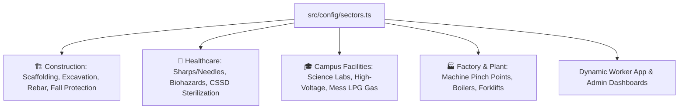
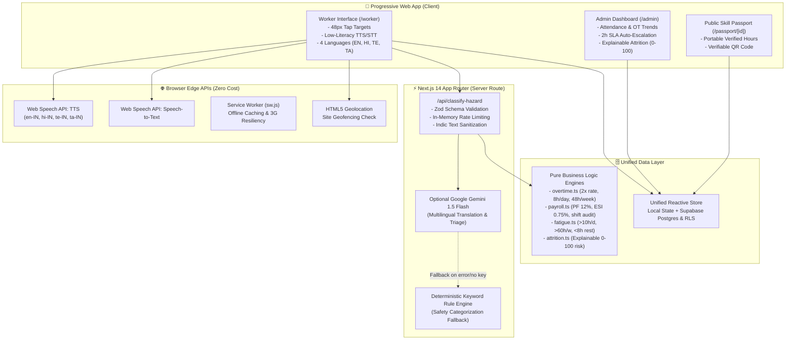

# FairShift 🛡️👷‍♂️
### UN SDG 8 (Decent Work & Economic Growth) • Production-Quality Mobile-First PWA

> **"Dignity, Fair Wages & Safe Shifts for Every Frontline Worker"**  
> FairShift is a mobile-first Progressive Web App engineered to eradicate wage theft, unrecorded overtime exploitation, hazardous working conditions, and occupational fatigue among contract, informal, and facility workers.

---

## 🌟 UN SDG 8 Alignment & Real-World Impact

| UN SDG Target | Systemic Frontline Challenge | The FairShift Solution |
| :--- | :--- | :--- |
| **Target 8.8: Safe & Secure Working Environments** | Hazardous conditions go unrecorded due to low literacy, fear of contractor retaliation, or language barriers. | **Multilingual Voice-to-Text Hazard Reporting** with AI severity classification, **2-hour SLA auto-escalation** for critical safety risks, and **100% untracked anonymous feedback** with mathematical $k$-anonymity ($k \ge 5$). |
| **Target 8.5: Decent Work & Fair Wages** | Opaque contractor deductions, unrecorded overtime, and arbitrary cash wage penalties. | **Indian Labour Law Compliance**: Automated 2.0× double wage for hours $>8\text{h/day}$ or $>48\text{h/week}$ (Factories Act Sec. 59), transparent itemized payslip linking directly to individual shift logs, and full **Text-to-Speech (TTS) read-aloud**. |
| **Target 8.8: Worker Health & Well-being** | 14-hour continuous shifts, sleep deprivation, and lack of mandatory rest intervals causing fatal site accidents. | **Algorithmic Fatigue Detection Matrix**: Flags $>10\text{h/day}$, $>60\text{h/week}$, $<8\text{h}$ rest gap between shifts, or $6+$ consecutive days with instant in-app alerts and supervisor rosters. |
| **Target 8.2 & 8.3: Economic Productivity & Skilling** | Informal workers lose proof of accumulated experience and technical skills when migrating between job sites. | **Portable Skill Passport (`/passport/[id]`)**: Verified work hours, trade certifications, and cross-sector credentials with a public shareable URL and smartphone-verifiable QR code. |

---

## 🏗️ Multi-Industry Adaptability (`src/config/sectors.ts`)

FairShift dynamically adapts its user vocabulary, hazard categories, shift templates, and skill certifications through a single strongly-typed configuration file:



### Seeded Organizations
1. **Sai Constructions (Guntur site)** — Sector: `construction` (Plot 42, Amaravati Ring Road, Guntur, AP)
2. **City Care Hospital** — Sector: `hospital` (Banjara Hills Road No. 12, Hyderabad, TS)
3. **SRM Campus Facilities** — Sector: `college` (Kattankulathur Campus, Chengalpattu Dist, TN)
*(Industrial Manufacturing sector configured and ready for turnkey expansion)*

---

## 📱 Two Seamless Interfaces

### A) Worker Mobile App (`/worker`)
- **Accessibility & Low-Literacy Design**: Minimum 48px tap targets, high contrast, large icon buttons, and works down to a 360px viewport.
- **Audio Read-Aloud on Every Label**: Integrated Web Speech API Text-to-Speech (TTS) reads any card, label, or metric in the worker's chosen language.
- **4 Regional Languages**: English, Hindi (हिन्दी), Telugu (తెలుగు), Tamil (தமிழ்) with complete JSON dictionary translations (`src/i18n/`).
- **Shift Check-in**: Scan site QR code or verify site GPS geofence with celebratory confetti animation.
- **Shift Live Timer**: Real-time counter showing elapsed hours and overtime breakdown.
- **Clear Payslip**: Visual cards with base pay, 2x overtime, statutory PF (12%) & ESI (0.75%), net take-home pay, and clickable shift traceability.
- **Voice Safety Reporting**: Microphone button transcribes voice in regional languages and allows site photo attachment.
- **Anonymous Feedback**: 1–5 emoji ratings for Supervisor, Safety, Pay, and Workload with privacy guarantee.
- **Skill Passport**: Instant access to public portable credential.

### B) Supervisor & HR Admin Dashboard (`/admin`)
- **Muster Board QR Generator**: Generates and prints official site check-in QR codes.
- **Real-Time Attendance**: Live active check-ins, completed shifts, and monthly hours.
- **Lazy-Loaded Overtime Trend Chart**: Visualizes daily standard vs. 2x overtime hours via Recharts.
- **Safety Hazard Triage**: Live breakdown by severity, action buttons (*Acknowledge*, *Mark Fixed*), and **2-hour SLA auto-escalation** for critical unacknowledged hazards.
- **Anonymous Feedback Gate ($k \ge 5$)**: Enforces mathematical $k$-anonymity. Individual scores and comments are revealed *only* when at least 5 responses exist.
- **Fatigue & Rest Watchlist**: Roster of workers exceeding daily/weekly hours or lacking mandatory 8-hour rest intervals.
- **Explainable Attrition Risk (0–100)**: Transparent, deterministic risk scoring based on attendance drops, overtime load, fatigue triggers, site morale, and open safety complaints—complete with human-readable explanations and actionable recommendations.

---

## 🏛️ System Architecture



---

## 🔒 Security & Privacy Guarantees

1. **Row Level Security (RLS)**: Comprehensive Postgres policies in `supabase/migrations/20261027000000_fairshift_init.sql` ensure workers read only their records and admins only their organization's data.
2. **Zero-Tracking Anonymous Feedback**: The `anonymous_feedback` database schema has **no worker ID or user ID column**. It is physically impossible to link feedback to a worker.
3. **$k$-Anonymity Gate**: Feedback aggregations are blocked on the admin dashboard until at least 5 submissions are received ($k \ge 5$).
4. **Server-Side AI API Keys**: `GEMINI_API_KEY` is strictly confined to server-side Next.js route handlers (`/api/classify-hazard`) and is never exposed to the client bundle.
5. **Input Validation & Sanitization**: Server-side request payloads are strictly validated using `zod`, HTML tags are stripped, and sliding-window rate limiters prevent API abuse.
6. **Zero PII Logging**: Operational logs never record personal telephone numbers or Aadhaar IDs.

---

## 🧮 Mathematical & Statutory Business Logic (`src/lib/`)

### 1. Overtime Calculation (`src/lib/overtime.ts`)
Under Section 59 of the Indian Factories Act (1948) and Minimum Wages Act:
$$\text{Hourly Wage} = \frac{\text{Daily Wage}}{8.0}$$
$$\text{Overtime Wage Rate} = \text{Hourly Wage} \times 2.0$$
- Single-shift threshold: Any duration $> 8.0\text{ hours}$ converts excess to overtime.
- Cumulative weekly threshold: Any regular hours exceeding $48.0\text{ hours}$ in a calendar week convert to overtime.

### 2. Statutory Wage Computation (`src/lib/payroll.ts`)
$$\text{Base Pay} = \text{Days Worked} \times \text{Daily Wage}$$
$$\text{Overtime Pay} = \text{Total OT Hours} \times (\text{Hourly Wage} \times 2.0)$$
$$\text{Gross Earnings} = \text{Base Pay} + \text{Overtime Pay}$$
$$\text{PF Deduction} = \text{Base Pay} \times 12\%$$
$$\text{ESI Deduction} = \text{Gross Earnings} \times 0.75\%$$
$$\text{Net In-Hand Pay} = \text{Gross Earnings} - (\text{PF} + \text{ESI})$$
*Full traceability*: Every payslip includes an array of shift UUIDs with individual date, regular hours, overtime hours, and earnings audit records.

### 3. Fatigue & Well-Being Engine (`src/lib/fatigue.ts`)
Detects 4 ergonomic risk triggers:
1. Daily hours $> 10.0\text{ hours}$
2. Rolling 7-day hours $> 60.0\text{ hours}$
3. Rest interval $< 8.0\text{ hours}$ between consecutive shifts
4. Consecutive working days $\ge 6\text{ days}$ without a mandatory 24-hour rest window.

### 4. Explainable Attrition & Retention Engine (`src/lib/attrition.ts`)
$$\text{Risk Score} = \min\left(100, \sum \text{Risk Penalties}\right)$$
- Fortnight attendance drop $> 35\%$: $+30\text{ pts}$ (or $>20\%$: $+18\text{ pts}$)
- Monthly overtime $> 25\text{ hours}$: $+25\text{ pts}$ (or $>15\text{ hours}$: $+15\text{ pts}$)
- Active critical fatigue trigger: $+25\text{ pts}$ (or warnings: $+10\text{ pts each}$)
- Workplace dissatisfaction (site feedback $< 2.5$): $+15\text{ pts}$
- Open unresolved safety complaints: $+18\text{ pts}$
*Every score is paired with an auditable list of human-readable factors and actionable interventions.*

---

## 🚀 Setup & Execution

### Prerequisites
- Node.js 18+ (tested on Node v20 & v24)
- npm 9+

### 1. Installation
```bash
git clone https://github.com/your-org/fairshift.git
cd fairshift
npm install
```

### 2. Configure Environment Variables
Copy `.env.example` to `.env.local`:
```bash
cp .env.example .env.local
```
*(Optional: Provide `GEMINI_API_KEY` for Google Gemini hazard translation, or leave blank to automatically use the built-in deterministic multilingual keyword rule engine).*

### 3. Run Automated Unit Tests
```bash
npm test
```
*Executes all 9 automated unit tests verifying overtime, payroll, fatigue, and attrition risk logic.*

### 4. Run Development Server
```bash
npm run dev
```
Open [http://localhost:3000](http://localhost:3000) in your browser.

- **Landing & Demo Launcher**: [http://localhost:3000](http://localhost:3000)
- **Worker App**: [http://localhost:3000/worker](http://localhost:3000/worker)
- **Admin Dashboard**: [http://localhost:3000/admin](http://localhost:3000/admin)
- **Sample Skill Passport**: [http://localhost:3000/passport/w-ramesh](http://localhost:3000/passport/w-ramesh)

---

## 🧪 Automated Test Suite Output

Running `npm test` executes the complete standalone test suite:
```
========================================================
   FAIRSHIFT CORE ENGINE: AUTOMATED TEST VERIFICATION  
========================================================

  ✓ [PASS] 1.1 Shift duration calculation minus break
  ✓ [PASS] 1.2 Daily 8h threshold and 2x overtime rate
  ✓ [PASS] 1.3 Weekly 48h ceiling triggers overtime
  ✓ [PASS] 2.1 Payroll calculation with PF 12%, ESI 0.75%, and 2x OT rate
  ✓ [PASS] 3.1 Fatigue flag for > 10 hours daily
  ✓ [PASS] 3.2 Fatigue flag for < 8h rest interval
  ✓ [PASS] 3.3 Fatigue flag for 6+ consecutive days
  ✓ [PASS] 4.1 Explainable attrition risk >= 70 severe when factors accumulate
  ✓ [PASS] 4.2 Low attrition risk for healthy worker

========================================================
 ALL 9 AUTOMATED UNIT TESTS PASSED SUCCESSFULLY!
========================================================
```

---

## ♿ Accessibility & PWA Checklist

- [x] **WCAG AA Compliance**: High-contrast color palette, visible focus rings (`:focus-visible`).
- [x] **Ergonomic Tap Targets**: All buttons, links, and switches comply with minimum $48 \times 48\text{px}$ touch zones.
- [x] **Web Speech API TTS**: Every single UI label, card, and warning can be read aloud in regional languages with one tap.
- [x] **Native Speech Recognition (STT)**: Workers can speak safety hazard reports and feedback directly using their smartphone mic.
- [x] **PWA Manifest & Service Worker**: `manifest.json` + `sw.js` enables standalone home-screen installation and offline caching on slow 2G/3G connections.
- [x] **Reduced Motion**: Respects `@media (prefers-reduced-motion: reduce)`.

---

## 📜 License & Hackathon Attribution
Developed with pride for the **UN SDG 8 Hackathon**.  
Dedicated to empowering frontline workers across India and developing economies with dignity, safety, and wage transparency.
